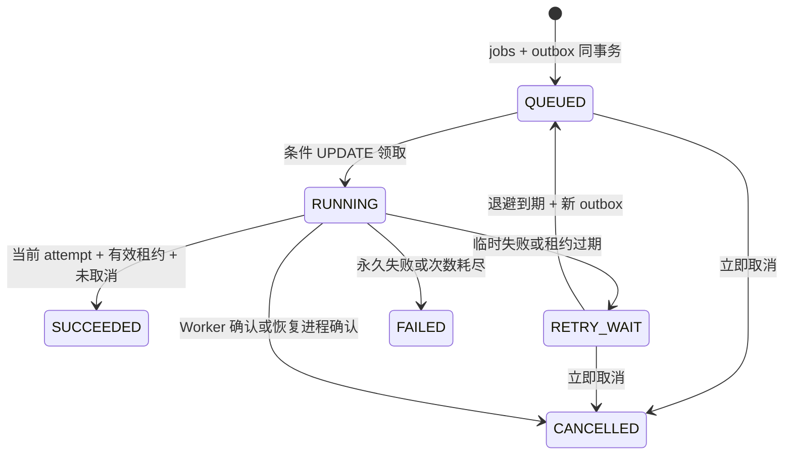

# 状态与一致性设计

## 状态机

## 事务边界

1. **上传**：分块写临时文件 → fsync → rename → fsync 目录 → files READY。数据库失败可能留下无引用上传对象，由宽限期清理回收。
2. **创建**：检查所属文件 → jobs → job_inputs → outbox → idempotency_keys → event，一次事务。唯一幂等键冲突时回滚新任务，读取胜者并核对规范化请求 hash（包含 parent_job_id）。
3. **派发**：读未发送 outbox → 网络发 job_id → 标记 sent_at。没有跨 Redis/数据库原子事务；重复派发必须由 Worker 处理。
4. **领取**：状态 QUEUED、到期、未取消、有剩余次数，条件 UPDATE 原子切为 RUNNING；新 attempt、事件一起提交。竞争失败不执行处理。
5. **心跳**：要求 RUNNING + current_attempt_id + lease_until > now，续租并更新本阶段行数。独立心跳线程覆盖阻塞 I/O；处理器检查点读取异常状态。
6. **提交**：独立 attempt 结果落盘后，条件 UPDATE 锁定 job；核对未取消，再创建 files 并设置 SUCCEEDED、result_file_id、finished_at。旧 attempt 即使继续写独立文件也无权绑定业务结果。
7. **恢复**：读取过期候选；再以状态、attempt 和到期条件 UPDATE。与心跳竞争后只有匹配者继续；使用统一业务计数重试。故障发生在 SQL 提交时，数据库原子性决定是否已成功；重复消息通过状态退出。

取消 endpoint 与最终成功提交都会写同一 job 行。已成功后取消无效；取消先提交，成功条件不成立。业务只通过 SUCCEEDED 的 result_file_id 提供下载，不暴露临时文件。

所有时刻使用 UTC。多主机模式还需要可靠时间同步以及共享/对象存储。当前默认部署为单主机，不隐藏这一条件。

## 幂等范围

- 请求幂等：同 owner + key + 参数内容映射同一个 job。
- 领取幂等：重复消息只允许一个有效执行尝试。
- 发布幂等：只有当前有效 attempt 可以提交一个结果；已结束状态不可重入。
- 手动 retry 是新任务，parent_job_id 指向失败任务；自动重试是原任务的新 attempt。

这保证业务结果不会因重复投递重复发布；并不保证计算本身从未重复。
