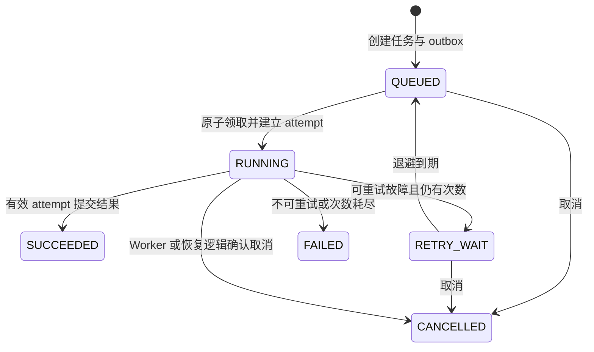

# 架构与一致性设计

DataFlow Jobs 将请求接收、任务调度和 CSV 计算拆成独立进程，以数据库记录任务状态，以文件存储保存输入和结果。本文说明一次任务如何完成，以及进程退出、重复消息或数据库中断时，系统如何决定哪些结果有效。

启动方式见 [README](../README.md)，日常操作见 [运维说明](operations.md)，实际验证结果见 [验收报告](verification.md)。

## 组件与运行模式

| 组件 | 职责 | 主要实现 |
| --- | --- | --- |
| API | 上传、校验请求、创建任务、查询与下载；不执行 CSV 计算 | [routes.py](../app/api/routes.py) |
| Service | 幂等、原子领取、续租、取消和结果提交 | [jobs.py](../app/services/jobs.py) |
| dispatcher | 派发 outbox、恢复过期租约、将到期重试重新排队 | [dispatcher.py](../app/scheduler/dispatcher.py)、[recovery.py](../app/scheduler/recovery.py) |
| Worker | 领取任务、读取输入、执行处理、写出结果 | [runner.py](../app/workers/runner.py) |
| maintenance | 归档闲置输入和历史事件、清理孤儿文件与过期心跳 | [maintenance.py](../app/scheduler/maintenance.py) |
| exporter | 从数据库聚合指标，供 Prometheus 采集 | [exporter.py](../app/observability/exporter.py) |

两种执行模式共用任务模型和处理器：

| 模式 | 数据库与消息路径 | 使用场景 |
| --- | --- | --- |
| `local` | 默认 SQLite；独立 Worker 轮询数据库，dispatcher 不发送 Redis 消息 | 本机体验、开发与小规模验证 |
| `celery` | Compose 使用 PostgreSQL；dispatcher 向 Redis 派发 `job_id`，Celery Worker 接收执行 | 单主机多进程部署与故障实验 |

本机模式仍需要 dispatcher：它负责租约恢复和到期重试，而不只是消息发送。Celery 模式中，消息仅携带任务 ID；参数、输入顺序、重试次数与业务状态均从数据库读取。

## 核心数据

| 表 | 保存的内容与约束 |
| --- | --- |
| `files` | 输入与结果元信息、存储键、大小、SHA-256，以及输入归档位置 |
| `jobs` | 状态、处理步骤、当前 attempt、租约、取消标志、结果引用与重试上限 |
| `job_inputs` | 文件与任务的关联，按 `input_order` 保留输入顺序 |
| `job_attempts` | 每次执行的 Worker、开始/结束时间、心跳、排队耗时与错误；同任务尝试序号唯一 |
| `outbox` | 待派发记录；同任务和派发代次唯一 |
| `idempotency_keys` | 所属账号与幂等键组成主键，关联请求摘要和任务 |
| `job_events` | 按事件 ID 查询的执行记录，单条详情最多 2000 字符 |
| `event_archives` | 每个任务至多一份事件归档索引，含摘要、数量和最后事件 ID |
| `component_heartbeats` | Worker、dispatcher、maintenance 进程存活记录 |
| `maintenance_state` | 最近维护开始、成功时间、错误和处理数量 |

模型定义见 [entities.py](../app/models/entities.py)。业务时间统一使用 UTC，API 使用 ISO 8601 表示。当前账号来自服务端固定配置；`owner_id` 查询约束不意味着已经实现多用户身份系统。

## 任务状态与执行尝试



`max_attempts` 包括首次执行，默认 3 次，最大 5 次。自动重试沿用原 `job_id`，每次领取生成新的 `attempt_id`；手动重试只接受 `FAILED` 任务，创建新任务并通过 `parent_job_id` 关联原任务。

临时存储、连接故障和过期租约可以重试；格式错误、输入丢失或其他不可重试错误直接结束。退避为 `retry_base_seconds × 2^(attempt_count−1)`，加上该延迟的 0–25% 随机抖动。

## 一次任务的事务边界

### 1. 上传与创建

上传先分块写入临时文件，计算大小和摘要，完成 `fsync`、重命名及目录同步后，再提交 `files` 记录。`READY` 表示文件已持久化；编码、表头与 CSV 内容在 Worker 执行时验证。

创建任务时，服务按文件 UUID 的固定顺序更新 `last_used_at`，同时核对所属账号与就绪状态。这一写锁也用于协调归档。随后在同一事务中写入任务、输入关联、outbox、可选幂等键和初始事件。

幂等请求摘要由规范化后的请求内容生成，包含 `parent_job_id`。相同账号和键对应相同内容时返回原任务，内容不同返回 `409`；并发请求通过唯一约束决定胜者。

### 2. 派发与领取

dispatcher 读取未发送 outbox，向 Redis 发送 `job_id`，随后记录 `sent_at`。消息发送与数据库提交不在一个事务中，发送后崩溃可能产生重复消息。

Worker 只在任务为 `QUEUED`、已到执行时间、未取消且仍有尝试次数时，通过条件 `UPDATE` 切换到 `RUNNING`。状态变化、新 attempt 和事件在同一事务提交；竞争失败的 Worker 不执行计算。

已标记发送但长期仍处于排队状态的任务会再次派发。当前等待阈值为 `max(60 秒, 2 × lease_seconds)`，用于覆盖 Redis 接收消息后丢失的情况。

### 3. 续租与计算

任务心跳、失败提交和成功提交均要求：

- 任务仍为 `RUNNING`；
- `current_attempt_id` 与当前执行匹配；
- `lease_until` 尚未过期。

独立心跳线程每隔租期的三分之一续租，覆盖处理器阻塞于 I/O 的情况。处理器检查点读取心跳错误和取消状态。心跳失败不会赋予旧 Worker 额外提交权；租约过期后，即使恢复进程尚未处理该任务，旧 attempt 也无法发布结果。

输入按顺序流式读取，去重和汇总分别维护唯一键与分组状态，因此内存还取决于数据基数，并受显式上限限制。

### 4. 结果发布

每次尝试使用独立路径：

```text
jobs/{job_id}/{attempt_id}/result.tmp
jobs/{job_id}/{attempt_id}/result.csv
```

结果完整写入并同步后重命名为最终文件，再通过条件更新锁定任务行，检查有效租约和取消标志。在同一数据库事务中创建结果元信息、设置 `result_file_id`、结束 attempt 并将任务改为 `SUCCEEDED`。

下载接口只提供成功任务所引用的文件。文件存在但数据库提交失败时，不会仅凭文件存在宣告任务成功；未被引用的文件在宽限期后按孤儿对象处理。若提交已经成功而客户端未收到确认，数据库中的成功状态仍然有效，重复消息不能重新领取该任务。

### 5. 取消与恢复

取消接口与结果提交都更新同一任务行。排队或等待重试的任务直接取消；运行中的任务设置 `cancel_requested`，由 Worker 或租约恢复逻辑确认终止。取消先提交时，成功发布条件不成立；成功先提交时，后续取消不改变成功状态。

恢复进程先查找租约过期候选，再以状态、attempt 和到期条件做第二次条件更新。与心跳竞争后，仅匹配的记录进入恢复；仍有次数则安排退避，次数耗尽则失败，已有取消请求则取消。

## 文件归档与清理

输入归档只处理 `uploads/` 下闲置到期、尚未归档、没有非终态任务引用的文件。压缩与摘要校验在数据库事务外完成，最终再次检查资格并更新文件记录；提交成功后才删除原始副本。

新任务创建与归档提交写入同一文件行。新任务先提交时，归档资格失效；归档先提交时，新任务使用归档对象。Worker 在自己的 attempt 目录临时解压，并核对原始大小与 SHA-256，结束时清理临时副本。

事件归档针对已过保留期的终态任务：先写入 JSONL.gz，再锁定任务，在同一事务内登记归档索引并删除对应在线事件。并发归档只有一个索引可以生效。孤儿清理保护数据库引用对象及 `RUNNING` 任务目录，并保留上传和提交所需的宽限期。

## 可观测性与边界

进程心跳与任务租约承担不同职责：前者在空闲时也持续上报，用于统计组件存活；后者只保护某次任务执行。进程心跳正常不能证明消费循环、所有 I/O 或每个任务都正常，需结合排队时长和过期租约判断。

指标由业务表聚合，API 重启不会重置数据库中的历史观测。任务指标按账号过滤，组件心跳按执行模式统计；当前属于单账号、单部署环境。历史规模增大时，需评估聚合查询成本。

系统保证有效状态转换和结果发布约束，允许故障恢复后重复计算。当前存储依赖同一主机的共享文件卷；跨主机扩展还需共享或对象存储，以及可靠的时间同步。多用户授权、任意代码执行、通用 DAG 和存储配额均不在当前实现范围内。
